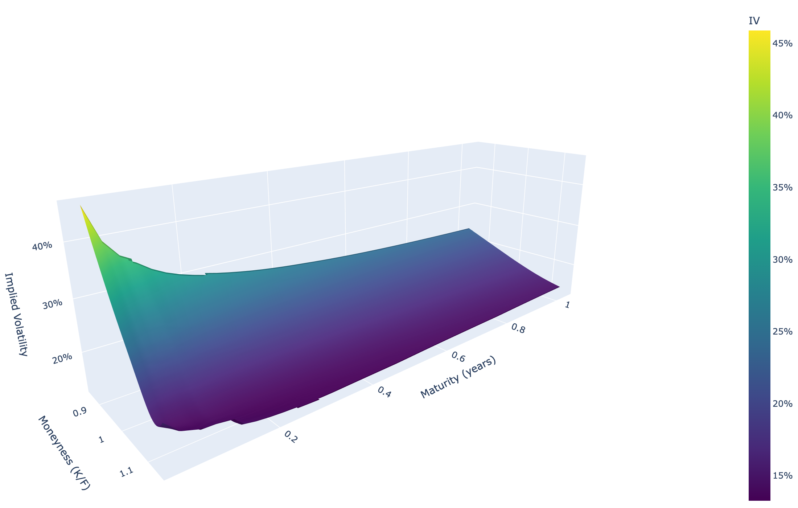
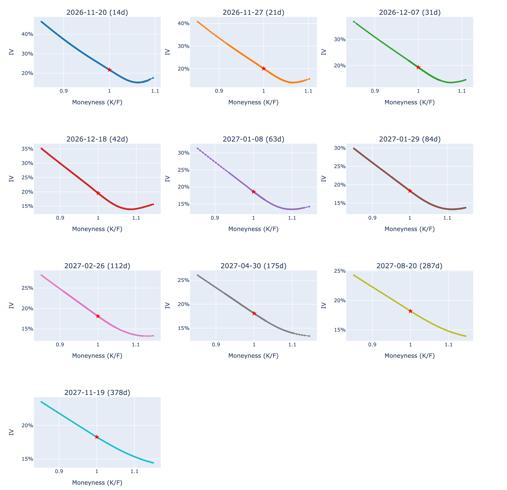
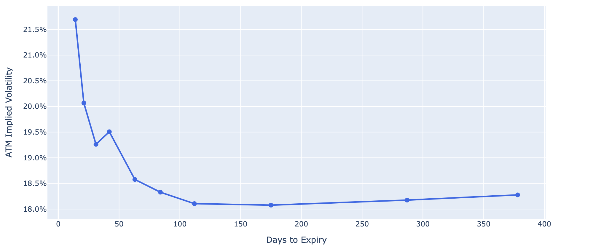

# SPX Equity Implied Volatility Surface Model

A Python tool that pulls **SPX (S&P 500 index) option quotes**, cleans them, and **computes implied volatility itself** by inverting Black-76 (Black-Scholes on the forward) on bid/ask mid prices. The risk-free rate comes from the US Treasury curve (FRED) and the forward / dividend yield is implied from put-call parity. It renders a single-page interactive dashboard with the full IV surface, per-expiry skew, and the ATM term structure.



---

## Quick start

```bash
git clone https://github.com/spenryhencer/spx-iv-surface.git
cd spx-iv-surface
python3 -m venv .venv
source .venv/bin/activate          # Windows: .venv\Scripts\activate
pip install -r requirements.txt
python iv_surface.py               # writes iv_dashboard.html and opens it
```

Run the tests with `python -m pytest`.

---

## Data sources

Choose with `--source`:

| Source | Flag | Cost / key | When it works | Notes |
|---|---|---|---|---|
| **Cboe delayed quotes** (default) | `--source cboe` | Free, no key | Any time — keeps the last session's closing bid/ask after hours and on weekends | ~15 min delayed. Public but undocumented endpoint, so it may change. Also gives Cboe's own IV, used as a cross-check. |
| **yfinance** (Yahoo Finance) | `--source yfinance` | Free, no key | **US market hours only** (9:30am–4pm ET) | Outside market hours Yahoo returns `bid = ask = 0` and placeholder IVs; the script detects this and tells you to switch source. |

Rates: US Treasury constant-maturity yields (1M, 3M, 6M, 1Y, 2Y) from [FRED](https://fred.stlouisfed.org/), no key needed. If FRED is unreachable it falls back to a flat 4% and says so on the dashboard.

---

## Methodology

For each selected expiry (nearest available to 14, 21, 30, 45, 60, 90, 120, 180, 270 and 365 days):

1. **Clean quotes** — keep two-sided quotes only (`bid > 0`, `ask > bid`), mid ≥ $0.05, relative spread `(ask − bid)/mid ≤ 50%`. Optional `--min-volume` / `--min-oi`. Mid prices are used, never last trade (which can be days stale).
2. **Rate** — Treasury yield interpolated to the option's maturity, converted to continuous compounding; `DF = e^(−rT)`.
3. **Forward** — put-call parity at the strikes nearest the money: `F = K + (C_mid − P_mid) / DF`. This gives the implied dividend yield `q = r − ln(F/S)/T` with no dividend forecast needed.
4. **OTM only** — puts for `K < F`, calls for `K ≥ F` (the liquid side of each strike); strikes within 85%–115% of F.
5. **Implied vol** — solve `Black76(F, K, T, DF, σ) = mid` with Brent's method; prices outside no-arbitrage bounds are dropped.
6. **Surface** — each smile is interpolated onto a common K/F grid, then maturities are interpolated linearly in total variance `σ²T`. No smoothing of the market points (optional `--smooth N`).

Time to expiry is measured in calendar time from the quote timestamp to settlement (4:00pm ET for PM-settled SPXW, 9:30am ET for AM-settled SPX monthlies; SPXW is preferred when both exist).

**Validation:** on the Cboe feed, the median gap between our IVs and Cboe's own published IVs is **0.09 vol points** across ~2,000 quotes (6 Nov 2026 close).

---

## Output

`iv_dashboard.html` — one self-contained page with:

| Section | What it shows |
|---|---|
| Summary cards | Spot, near/long-dated ATM IV, term-structure shape, 30-day 25Δ risk reversal, risk-free rate, implied dividend yield, IV cross-check vs the source |
| 3-D surface | IV across moneyness (K/F) and maturity |
| Smile grid | IV vs K/F for each expiry; hover shows strike, put/call and bid/ask |
| Term structure | ATM-forward IV by days to expiry |
| Per-expiry table | Rate, forward, dividend yield, ATM IV and point count used for each expiry |

Snapshot from the 6 Nov 2026 close (Cboe feed):




---

## Command-line options

```
python iv_surface.py [--source cboe|yfinance] [--moneyness LO HI]
                     [--max-spread X] [--min-mid X] [--min-volume N] [--min-oi N]
                     [--smooth N] [--out FILE] [--csv FILE] [--png DIR] [--no-open]
```

| Option | Default | Description |
|---|---|---|
| `--source` | `cboe` | Data source |
| `--moneyness` | `0.85 1.15` | K/F range kept |
| `--max-spread` | `0.5` | Max relative bid/ask spread |
| `--min-mid` | `0.05` | Min mid price ($) |
| `--min-volume`, `--min-oi` | `0` | Optional liquidity floors |
| `--smooth` | `0` | Rolling-median window across strikes (0 = off) |
| `--out` | `iv_dashboard.html` | Dashboard path |
| `--csv` | — | Also save the cleaned IV points |
| `--png` | — | Also save chart PNGs (needs `kaleido` + Google Chrome) |
| `--no-open` | — | Don't open the browser |

---

## Project structure

```
spx-iv-surface/
├── iv_surface.py        # CLI, cleaning + IV pipeline, dashboard
├── providers.py         # Cboe and yfinance data providers
├── pricing.py           # Black-76, IV inversion, put-call-parity forward
├── rates.py             # FRED Treasury curve
├── tests/               # pytest unit tests
├── docs/                # screenshots used in this README
└── requirements.txt
```

---

## Changelog

**v2 (Nov 2026)**
- Added the **Cboe delayed-quotes provider** (now the default) alongside yfinance, selectable with `--source`.
- IV is now **computed in-house** (Black-76 + Brent) from bid/ask mids. v1 plotted Yahoo's pre-computed `impliedVolatility` field, which outside market hours is a placeholder (e.g. 0.00001, 3.1%, 6.25%, 12.5%).
- Added the Treasury rate curve (FRED), put-call-parity forwards and implied dividend yields.
- Bid/ask spread and mid-price filters; OTM-only selection; true 25Δ risk reversal; ATM measured at the forward.
- Surface built per expiry and interpolated in total variance (replaces `griddata` over strike × maturity).
- CLI options, CSV/PNG export, unit tests.

---

## Disclaimer

This project is for **educational purposes only** and is not financial advice. Quotes are delayed and may be inaccurate.
